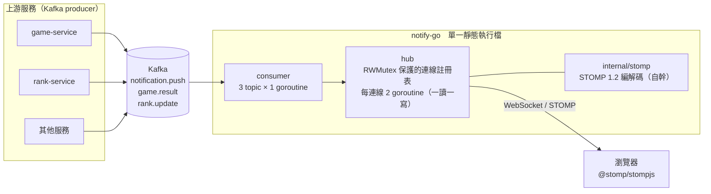

# Lucky Star Notify (Go)

[](https://github.com/AlexChang1999/Lucky_Star_Notify_Go/actions/workflows/ci.yml)

**消費 Kafka 事件，透過 WebSocket / STOMP 即時推播給線上玩家。**
把一個 Java 21 / Spring Boot 3.3.5 的服務用 Go 重寫，並**證明兩個實作行為等價**。

這個專案想證明的不是「我會用 Go 寫 CRUD」，而是兩件事：

| | |
|---|---|
| 🔌 **協議層自己寫得出來** | Go 生態沒有現成的 STOMP **伺服器**實作。`internal/stomp` 照 1.2 規格自己刻，**零外部依賴**，含 header 轉義、心跳協商與模糊測試 |
| 🤝 **兩個實作真的等價** | 一份與語言無關的黑箱契約測試，對 Java 版（8087）與 Go 版（8088）**各 14/14 全綠** |

> 原版是我大專小組專案 `Lucky_Star_Casino` 的 `notification-service`。
> 本 repo **獨立、可單獨運行**，不需要拿到團隊 repo。

---

## 30 秒看懂



**三條推播路徑**（前端實際依賴的契約）：

| Kafka topic | 送到哪裡 | body |
|---|---|---|
| `game.result` | `/user/queue/notifications`（只給下注的玩家） | **重組過**的通知：`type` 在最前面、**不含 `playerId`** |
| `notification.push` | 有 `targetPlayerId` → 私人；沒有 → `/topic/notifications` | 原事件回吐 |
| `rank.update` | `/topic/rank`（廣播） | 原事件回吐 |

三者形狀**刻意不一致**——那是原版的真實行為，統一它們就不等價了。

---

## 一行啟動

```bash
docker compose -f deploy/docker-compose.yml up --build -d --wait
```

打開 **<http://localhost:8090>** ——自帶的假上游每 3 秒發一則事件，
頁面用業界標準的 `@stomp/stompjs` 連上 `:8088`，訊息會即時跳出來。
**不需要團隊 repo，不需要裝 Go。** 啟動時間主要花在等 Kafka 就緒。

開兩個分頁、各自選不同玩家，可以看到私人推播只進正確的那一個。

想順便看指標：

```bash
docker compose -f deploy/docker-compose.yml --profile observability up -d
# Prometheus http://localhost:9091 、Grafana http://localhost:3001（dashboard 已預先配好）
```

> ⚠️ 收工時若開過 `observability`，`down` 也要帶同一個 `--profile`，
> 否則那兩個容器會留著、網路刪不掉。

---

## 「行為等價」是怎麼證明的

宣稱等價很便宜，所以這裡用一份**與語言無關**的黑箱契約測試來擔保：
Node.js + `@stomp/stompjs` + `kafkajs`，只吃三個環境變數
（`WS_TARGET` / `KAFKA_BROKER` / `JWT_SECRET`），
**測試碼裡沒有任何一行認得出對面是 Java 還是 Go**。

```bash
cd test/contract && npm ci
CONTRACT_TARGET=go   npm test    # Go 版   → 14/14
CONTRACT_TARGET=java npm test    # Java 版 → 14/14
```

```
契約測試目標：go　WS=ws://localhost:8088/ws　Kafka=localhost:9094
ℹ tests 14   ℹ pass 14   ℹ fail 0

契約測試目標：java　WS=ws://localhost:8087/ws　Kafka=localhost:9092
ℹ tests 14   ℹ pass 14   ℹ fail 0
```

刻意用第三方 client 而不是自己寫一個：用自家 client 測自家 server，
證明的只是「我的兩份實作互相相容」；用前端實際在用的那一支，證明的才是**與規格相容**。

測的不只是「收得到訊息」，還包括幾個**天生沒有錯誤訊息**的差異——
`game.result` 的推播不含 `playerId`、`null` 欄位是「存在且為 null」而不是消失、
MESSAGE 帧一定帶 `subscription` 與 `message-id`（漏了的話 client 會**靜默丟棄**）、
JSON 不做 HTML 轉義（Go 的 `encoding/json` 預設會轉、Jackson 不會）、
以及 `alg: none` 等五種爛憑證都必須回 ERROR 並斷線。
逐項說明見 [`test/contract/README.md`](test/contract/README.md)。

Go 這一側**跑在 CI 裡**，所以等價性不會因為之後某次改動而無聲失效。

---

## 技術決策

| 決策 | 摘要 |
|---|---|
| [ADR-001 為什麼用 Go 重寫推播服務](docs/ADR-001-為什麼用-Go-重寫推播服務.md) | 為什麼選這個服務（邊界最乾淨、風險最低、Go 的優勢用得上），**以及原架構只能單副本這個限制** |
| [ADR-002 STOMP 子集的取捨](docs/ADR-002-STOMP-子集的取捨.md) | 做哪些指令、為何不做 SockJS、為何扇出用 RWMutex 而不是中央 goroutine |

三個值得單獨講的實作決定：

**扇出用 `RWMutex` 而不是中央 goroutine。**
推播是讀多寫少（連線進出遠少於廣播），RWMutex 讓廣播可以並行；
中央 goroutine 會把所有廣播序列化成一條。

**慢速客戶端用非阻塞寫入 + 驅逐。**
廣播迴圈是 `select { case ch <- msg: default: 驅逐 }`。
寫成阻塞的 `ch <- msg`，**一個卡住的 client 就能拖垮整個廣播迴圈**。
驅逐次數有計數器（`notify_outbound_dropped_total`），不會靜靜地發生。

**每條連線固定兩個 goroutine，一讀一寫，所有寫入都走 outbound channel。**
`gorilla/websocket` 同時只允許一個 reader 與一個 writer。
連 CONNECTED 握手回覆都交給 write goroutine 送——這樣「client 收到 CONNECTED」
就保證「session 已登記進 hub」，中間不會有一段推播會漏掉的空窗期。

---

## 開發

需要 **Go 1.25+**。

```bash
go vet ./...
go test -race ./...          # ★ -race 是硬性要求，不是選配
golangci-lint run
go build ./...
```

**`go test -race` 值得特別提一句：Java 沒有等價的工具。**
這是一個併發服務，沒有競態偵測器的測試等於沒測——而 Go 把它放在標準工具鏈裡。

```bash
# 只跑 STOMP 協議層，含覆蓋率
go test -race -cover ./internal/stomp/

# 模糊測試：找畸形輸入導致的 panic
go test -fuzz=FuzzReadFrame -fuzztime=30s ./internal/stomp/
```

CI（[`.github/workflows/ci.yml`](.github/workflows/ci.yml)）跑三個 job：
靜態檢查與測試、映像建置（含 **20 MB 大小上限斷言**）、
以及 compose 端到端煙霧測試 + 契約測試。

### 設定

| 環境變數 | 預設 | 說明 |
|---|---|---|
| `JWT_SECRET` | **必填** | ≥ 32 bytes，**原始字串不是 base64** |
| `PORT` | `8088` | |
| `ALLOWED_ORIGINS` | `*` | 逗號分隔 |
| `LOG_LEVEL` | `INFO` | |
| `KAFKA_BOOTSTRAP_SERVERS` | `localhost:9092` | 明確給空字串 = 不啟動 consumer |
| `KAFKA_GROUP_ID` | `notification-service-go-group` | **必須與 Java 版不同**，否則兩邊會搶 partition |
| `DEBUG_PUSH` | `true` | ⚠️ 這個端點**沒有鑑權**，接上 Kafka 或任何對外部署都必須設 `false` |
| `GOMEMLIMIT` | — | 與容器記憶體上限成對設定 |

缺必填或值不合法**一律拒絕啟動**，而且一次回報所有問題。

### 端點

`GET /ws`（WebSocket）、`GET /actuator/health`、
`GET /metrics` 與 `GET /actuator/prometheus`（同一個 handler 註冊兩次，
方便直接接上團隊既有的 Prometheus）。

自訂指標：`notify_ws_connections`、`notify_outbound_dropped_total`、
`notify_kafka_messages_total{topic,result}`、`notify_push_latency_seconds`。

---

## 進度

| Phase | 內容 | 狀態 |
|---|---|---|
| 0 | 前端脫離 SockJS（改原生 WebSocket） | ✅ *（1 項端到端驗證待補，見下）* |
| 1 | Go 骨架 + STOMP 帧編解碼 + JWT 驗章 + 握手 | ✅ |
| 2 | Hub / 訂閱 / 推播 / 心跳 / 背壓 | ✅ |
| 3 | Kafka 三個 consumer | ✅ |
| 4 | 容器化 / 觀測性 / 獨立 compose / CI | ✅ |
| 5 | 契約測試 / ADR / README | ✅ |

Phase 0 唯一沒打勾的是「登入 → 玩一局 → 收到 `GAME_RESULT`」這條**完整**端到端路徑，
它需要整套團隊 stack（gateway + member + game + Kafka）。
WS 握手、訂閱與私人推播本身已由團隊 repo 自己的
`WebSocketStompIntegrationTest`（原生 WebSocket、無 SockJS）涵蓋並實測通過，
所以「Go 版不必實作 SockJS」這個前提是成立的。補做步驟見
[`docs/phase0-前端脫離-SockJS.md`](docs/phase0-前端脫離-SockJS.md) §3。

逐項 DoD 見 [`計畫說明書.md`](計畫說明書.md) §6；
開發約定與**累積下來的 32 條地雷**見 [`AGENTS.md`](AGENTS.md)。
